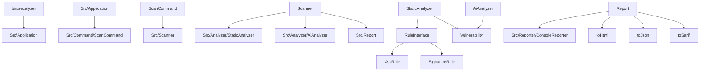

<!-- header:start -->
<div align="center">



<a href="#-quick-start"></a>

<a href="LICENSE"></a>

<a href="https://github.com/ajendras/secalyzer/stargazers"></a>
<a href="https://github.com/ajendras/secalyzer/actions/workflows/ci.yml"></a>

<a href="CONTRIBUTING.md"></a>

**Scans PHP CMS plugins, themes and web apps for vulnerabilities with static rules plus optional AI-powered analysis.**

[✨ Features](#-features) • [⚡ Quick start](#-quick-start) • [🧰 Usage](#-usage) • [🧩 Architecture](#-architecture) • [📍 Roadmap](#-roadmap) • [🤝 Contributing](#-contributing)

</div>
<!-- header:end -->

## ✨ Why Secalyzer?

Self-hosted CMS projects like kestellohq/cms ship plugins and themes that often contain subtle injection or signing flaws. Existing PHP scanners are noisy, miss context, or lack remediation guidance. Secalyzer gives PHP developers building client sites a fast, accurate, and automated security gate with both deterministic rules and LLM assistance.

- **Context-aware detection** — AST-based rules understand data flow instead of relying on brittle regex
- **Optional AI co-pilot** — sends only suspicious snippets to OpenAI for deeper contextual review
- **Ready-to-apply fixes** — every `Vulnerability` includes concrete remediation code or patches
- **CMS-first design** — special `SignatureRule` and plugin/theme isolation patterns plus SARIF export for GitHub
- **Beautiful, actionable output** — color-coded terminal tables, severity gauges, and self-contained HTML reports

## 🎬 Demo

<p align="center"></p>

## 🚀 Features

<table>
<tr>
<td valign="top" width="33%">
🔎 <b>20+ Rules</b><br>
Detects XSS, SQLi, unsafe deserialization, weak randomness and signing bypasses
</td>
<td valign="top" width="33%">
🧠 <b>AST Analysis</b><br>
Uses nikic/php-parser NodeTraverser instead of regex for precise context
</td>
<td valign="top" width="33%">
🤖 <b>LLM Assistant</b><br>
AiAnalyzer sends focused snippets to OpenAI when --ai-key is provided
</td>
</tr>
<tr>
<td valign="top">
🛠️ <b>Fix Suggestions</b><br>
Every Vulnerability carries a suggestedFix with ready-to-apply code
</td>
<td valign="top">
🏠 <b>CMS Mode</b><br>
SignatureRule and plugin/theme isolation rules tailored for modern CMS
</td>
<td valign="top">
📊 <b>Beautiful Output</b><br>
ConsoleReporter with SymfonyStyle tables, severity gauges and remediation hints
</td>
</tr>
<tr>
<td valign="top">
📤 <b>Multiple Formats</b><br>
Report::toJson(), toSarif(), toHtml() and console output
</td>
<td valign="top">
⚙️ <b>Configurable</b><br>
--config JSON for ignore paths, severity thresholds and custom rules
</td>
<td></td>
</tr>
</table>

## 📦 Installation

**Requirements:** PHP 8.2+, Composer

```bash
composer global require ajendras/secalyzer
```

Make sure `~/.composer/vendor/bin` is in your PATH, then run:

```bash
secalyzer scan ./my-cms --ai-key sk-...
```

## ⚡ Quick start

```bash
secalyzer scan ./plugin --format=console
```

This scans the directory with all static rules (`XssRule`, `SignatureRule`, etc.), outputs a color-coded table via `ConsoleReporter`, and returns exit code 1 if any critical or high findings are present.

## 🧰 Usage

Scan a theme with AI assistance and HTML report:

```bash
secalyzer scan ./wp-theme --ai-key sk-... --format=html
```

Export SARIF for GitHub Code Scanning:

```bash
secalyzer scan . --format=sarif > secalyzer.sarif
```

Include fix suggestions (always part of each `Vulnerability`):

```bash
secalyzer scan ./plugin --fix
```

<details><summary>Advanced: use a config file and JSON output</summary>

```bash
secalyzer scan ./cms \
  --config ./secalyzer.json \
  --format=json > report.json
```

Example `secalyzer.json` (parsed by `ScanCommand`):

```json
{
  "ignore": ["vendor", "tests"],
  "severity_threshold": "high"
}
```

</details>

## 🔧 Configuration

| Option          | Default      | Description |
|-----------------|--------------|-------------|
| `path` (argument) | current working directory | Directory or single file to scan |
| `--ai-key` / `-k` | null | OpenAI API key (must start with `sk-`); enables `AiAnalyzer` |
| `--format` / `-f` | `console` | One of: `console`, `html`, `json`, `sarif` |
| `--fix`         | false | Include detailed `suggestedFix` in output (always stored in `Vulnerability`) |
| `--config` / `-c` | null | Path to JSON config for ignore paths, severity threshold and custom rules |

## 🧩 Architecture



`ScanCommand` parses Symfony Console options and calls `Scanner::scan(string $path, array $options)`. The orchestrator runs `StaticAnalyzer::analyze()` on every PHP file (using `nikic/php-parser` and a `NodeVisitor`), optionally augments findings with `AiAnalyzer::analyze()`, then assembles an immutable `Report` that can be rendered by `ConsoleReporter` or exported in multiple formats.

## 📁 Project structure

```text
.
├── bin/
│   └── secalyzer              # shebang entrypoint, locates autoloader, calls Src\Application::run()
├── src/
│   ├── Application.php        # registers ScanCommand and sets default command
│   ├── Command/
│   │   └── ScanCommand.php    # Symfony Command with --ai-key, --format, --fix, --config
│   ├── Scanner.php            # orchestrates StaticAnalyzer + optional AiAnalyzer
│   ├── Analyzer/
│   │   ├── StaticAnalyzer.php # AST traversal + RuleInterface execution
│   │   └── AiAnalyzer.php     # OpenAI Chat API via Guzzle, parses JSON response
│   ├── Rule/
│   │   ├── RuleInterface.php  # getName(), getSeverity(), check(Node, file)
│   │   ├── XssRule.php
│   │   └── SignatureRule.php
│   ├── Model/
│   │   └── Vulnerability.php  # immutable DTO with suggestedFix and confidence
│   ├── Report.php             # toConsole(), toHtml(), toJson(), toSarif(), countBySeverity()
│   └── Reporter/
│       └── ConsoleReporter.php # SymfonyStyle tables, gauges, remediation section
├── tests/
│   └── StaticAnalyzerTest.php # PHPUnit tests for XssRule, SignatureRule and AST matching
├── composer.json
└── LICENSE
```

## 🧪 Testing

```bash
composer test
# or
vendor/bin/phpunit
```

The test suite (`StaticAnalyzerTest.php`) covers rule registration, AST node matching for `XssRule` and `SignatureRule`, data-provider driven vulnerability creation, and edge cases such as unreadable files and parse errors.

## 📍 Roadmap
<!-- roadmap:start -->
- [x] **v0.1.0** — first release: 20+ Rules, AST Analysis, LLM Assistant, Fix Suggestions
- [ ] Add configuration file support (.secalyzer.json)
- [ ] Implement 12 additional security rules (CSRF, SSRF, deserialization)
- [ ] Generate and apply automatic patches using diff syntax
- [ ] Add Laravel and Symfony specific rule sets
- [ ] Support Anthropic Claude and local Ollama as LLM backends
- [ ] Produce SARIF output for native GitHub code scanning integration
- [ ] Baseline mode to ignore previously acknowledged issues
- [ ] Plugin architecture for third-party rules
- [ ] Interactive HTML report with code snippet highlighting
- [ ] Docker image and GitHub Action for zero-config CI
- [ ] Historical trend tracking and security score over time
- [ ] Slack and email notifications for high-severity findings

> 🤖 This roadmap is worked through continuously — ideas and PRs welcome!
<!-- roadmap:end -->

## 🤝 Contributing

Contributions are welcome and appreciated! Please read our [CONTRIBUTING.md](https://github.com/ajendras/secalyzer/blob/main/CONTRIBUTING.md) and follow the [CODE_OF_CONDUCT.md](https://github.com/ajendras/secalyzer/blob/main/CODE_OF_CONDUCT.md).  

Good first issues include new `RuleInterface` implementations, improved HTML report styling, and test coverage for additional AST patterns. Fork the repo, open a PR, and let's make PHP CMS security scanning better together.

## 📄 License

This project is licensed under the MIT License — see the [LICENSE](https://github.com/ajendras/secalyzer/blob/main/LICENSE) file for details.

<!-- footer:start -->
<div align="center">

### ⭐ Star history

<a href="https://star-history.com/#ajendras/secalyzer&Date"></a>

If **Secalyzer** saves you time, a ⭐ helps others find it.

Made with ❤️ by [Ajendra](https://ajendra.info)


</div>
<!-- footer:end -->
